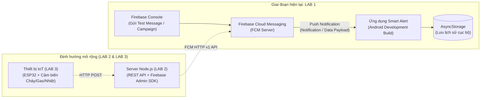

# BÁO CÁO BÀI THỰC HÀNH LAB 1
## ĐỀ TÀI: XÂY DỰNG ỨNG DỤNG DI ĐỘNG "SMART ALERT" NHẬN THÔNG BÁO ĐẨY (PUSH NOTIFICATION) TỪ FIREBASE CLOUD MESSAGING

---

## 1. MỤC TIÊU BÀI LAB

1. **Nắm vững cơ chế Push Notification thực tế:** Hiểu và triển khai quy trình kết nối ứng dụng di động React Native (Expo) trực tiếp với **Firebase Cloud Messaging (FCM)** mà không phụ thuộc dịch vụ trung gian Expo Push Service.
2. **Xây dựng ứng dụng hoàn chỉnh "Smart Alert — Hệ thống cảnh báo thông minh":**
   - Khởi tạo Firebase Native trên nền tảng Android thông qua file cấu hình `google-services.json`.
   - Quản lý quyền nhận thông báo đẩy trên Android 13 trở lên (`POST_NOTIFICATIONS`).
   - Lấy **FCM Registration Token** thực tế của thiết bị, hỗ trợ sao chép và tự động cập nhật khi token thay đổi (`onTokenRefresh`).
   - Xử lý đầy đủ các trạng thái nhận thông báo: khi ứng dụng đang mở (**Foreground**), khi chạy nền (**Background**), khi đã đóng hoàn toàn (**Terminated/Quit**), và sự kiện người dùng nhấn vào thông báo (**Notification Tap**).
   - Lưu trữ bền vững lịch sử thông báo trên thiết bị bằng **AsyncStorage**, có cơ chế chống trùng lặp theo `messageId`/`eventId`.
3. **Thiết kế kiến trúc sẵn sàng mở rộng:** Đảm bảo ứng dụng hoạt động độc lập trong **LAB 1** (gửi thử từ Firebase Console) và tương thích hoàn toàn để tích hợp với **LAB 2** (Server Node.js REST API) và **LAB 3** (Hệ thống cảm biến IoT cảnh báo sự cố).

---

## 2. CÔNG NGHỆ SỬ DỤNG

| Thành phần | Công nghệ / Thư viện | Phiên bản | Vai trò trong dự án |
| :--- | :--- | :--- | :--- |
| **Framework chính** | React Native + Expo | SDK 52 (`RN 0.76`) | Nền tảng phát triển ứng dụng đa nền tảng, hỗ trợ Config Plugins và Development Build. |
| **Ngôn ngữ** | TypeScript | `~5.3.3` | Kiểm tra kiểu tĩnh nghiêm ngặt (`strict: true`), định nghĩa rõ cấu trúc Payload FCM. |
| **Điều hướng** | Expo Router | `~4.0.17` | Điều hướng dạng File-based routing (Bottom Tabs kết hợp Stack Navigation). |
| **Push Notification (Gốc)** | `@react-native-firebase/app` & `@react-native-firebase/messaging` | `^21.11.0` | Kết nối trực tiếp SDK Native của Firebase Cloud Messaging trên Android. |
| **Kênh thông báo cục bộ** | `expo-notifications` | `~0.29.13` | Chỉ dùng để khởi tạo Notification Channel mức ưu tiên cao (`MAX`) trên Android 8+ và hiển thị banner khi App đang ở Foreground (không dùng Expo Push Token). |
| **Lưu trữ cục bộ** | `@react-native-async-storage/async-storage` | `1.23.1` | Lưu lịch sử thông báo và cài đặt người dùng bền vững khi đóng/mở lại ứng dụng. |
| **Kiểm tra mạng** | `@react-native-community/netinfo` | `11.4.1` | Giám sát trạng thái kết nối mạng thời gian thực để cảnh báo khi mất Internet. |
| **Tiện ích giao diện** | `@expo/vector-icons`, `expo-clipboard` | Tương thích SDK 52 | Hiển thị icon trực quan cho 6 loại cảnh báo và sao chép nhanh FCM Token. |

---

## 3. KIẾN TRÚC HỆ THỐNG

### 3.1. Sơ đồ luồng dữ liệu trong LAB 1 (và định hướng mở rộng LAB 2, LAB 3)

### 3.2. Kiến trúc phân tầng trong mã nguồn (`smart-alert-app/`)
- **Tầng Giao diện (`app/`, `components/`):** Gồm 4 màn hình chính (Trang chủ Dashboard, Danh sách thông báo, Chi tiết thông báo, Cài đặt Firebase) và các component tái sử dụng (`NotificationCard`, `ForegroundAlertToast`, `StatusBadge`).
- **Tầng Quản lý trạng thái (`hooks/useSmartAlert.tsx`):** Quản lý vòng đời kết nối Firebase, lắng nghe sự kiện mạng (`NetInfo`), trạng thái đóng/mở ứng dụng (`AppState`), đồng bộ danh sách thông báo và cung cấp các thao tác (đánh dấu đã đọc, xóa, làm mới token).
- **Tầng Dịch vụ (`services/firebaseMessagingService.ts`, `services/storageService.ts`):** Đóng gói toàn bộ lệnh gọi tới `@react-native-firebase/messaging` và `AsyncStorage`.
- **Tầng Định nghĩa & Phân tích dữ liệu (`types/`, `utils/formatters.ts`, `constants/`):** Chuẩn hóa việc bóc tách `RemoteMessage` từ Firebase mà không tự bịa thêm dữ liệu nếu payload không cung cấp.

---

## 4. QUY TRÌNH TRIỂN KHAI

1. **Khởi tạo dự án & Cấu hình TypeScript:** Thiết lập dự án Expo Router với cấu trúc thư mục rõ ràng (`app`, `components`, `services`, `hooks`, `types`, `constants`, `utils`).
2. **Thiết lập cấu hình Native Android (`app.config.ts`):**
   - Khai báo `android.package = "com.smartalert.app"`.
   - Liên kết file `./google-services.json`.
   - Khai báo quyền `android.permission.POST_NOTIFICATIONS` cho Android 13+.
   - Tích hợp config plugins `@react-native-firebase/app` và `@react-native-firebase/messaging`.
3. **Triển khai dịch vụ Firebase Messaging (`firebaseMessagingService.ts`):**
   - Kiểm tra và yêu cầu quyền thông báo.
   - Lấy FCM Token thực tế bằng `messaging().getToken()`.
   - Đăng ký các hàm lắng nghe: `onTokenRefresh`, `onMessage` (Foreground), `setBackgroundMessageHandler` (Background), `onNotificationOpenedApp` (nhấn thông báo khi chạy nền), và `getInitialNotification` (nhấn thông báo khi App đã đóng).
4. **Triển khai lưu trữ lịch sử (`storageService.ts`):**
   - Lưu danh sách thông báo vào `AsyncStorage` dưới khóa `@smart_alert/notification_history_v1`.
   - Kiểm tra trùng lặp dựa trên `messageId` và `eventId` trước khi thêm mới.
5. **Xây dựng 4 màn hình giao diện tiếng Việt:** Thiết kế hiện đại với tông màu xanh dương chủ đạo, phân biệt màu sắc và biểu tượng theo từng loại cảnh báo (`FIRE`, `GAS_LEAK`, `HIGH_TEMP`, `LOW_TEMP`, `INTRUSION`, `SYSTEM_CHECK`).

---

## 5. GIẢI THÍCH CƠ CHẾ FIREBASE CLOUD MESSAGING (FCM)

### 5.1. Phân biệt Notification Payload và Data Payload
Trong FCM, một bản tin gửi xuống thiết bị có thể thuộc 1 trong 3 dạng:
1. **Notification-only Payload:** Chỉ chứa khối `notification: { title, body }`.
2. **Data-only Payload:** Chỉ chứa khối `data: { key: "value", ... }`.
3. **Notification + Data Payload (Hỗn hợp):** Chứa cả `notification` và `data` (ví dụ khi gửi từ Firebase Console kèm phần *Additional options -> Custom data*).

### 5.2. Cơ chế xử lý theo từng trạng thái ứng dụng trên Android

| Trạng thái ứng dụng | Notification Message (có khối `notification`) | Data-only Message (chỉ có khối `data`) | Cách ứng dụng Smart Alert xử lý |
| :--- | :--- | :--- | :--- |
| **1. Foreground (Đang mở trên màn hình)** | Chuyển thẳng vào hàm `messaging().onMessage()` trong JS; hệ thống Android **không** tự bung thông báo trên thanh trạng thái. | Chuyển thẳng vào hàm `messaging().onMessage()`. | Lưu ngay vào `AsyncStorage`, cập nhật danh sách trên UI, hiện `ForegroundAlertToast` và bung thêm thông báo cục bộ qua kênh `smart_alert_high_importance`. |
| **2. Background (Đang chạy ngầm)** | Hệ điều hành Android (Google Play Services) **tự động hiển thị** thông báo trên thanh trạng thái. Khi người dùng nhấn vào thông báo, `onNotificationOpenedApp` sẽ được gọi kèm toàn bộ payload. | Đánh thức `setBackgroundMessageHandler` chạy ngầm để xử lý dữ liệu. | Không tự gọi thêm thông báo cục bộ đối với Notification Message để **tránh trùng lặp 2 thông báo**. Khi người dùng nhấn vào thông báo, App lưu/cập nhật vào `AsyncStorage` và mở thẳng màn hình Chi tiết. |
| **3. Terminated / Quit (Đã vuốt đóng hoàn toàn)** | Hệ điều hành Android vẫn hiển thị thông báo trên thanh trạng thái. Khi người dùng nhấn vào thông báo, App khởi động và `getInitialNotification()` trả về bản tin đó. | Phụ thuộc mức ưu tiên (`priority: high`) và chính sách tiết kiệm pin của hãng điện thoại. | Khi người dùng nhấn vào thông báo để mở App, `getInitialNotification()` bắt lấy payload, lưu vào `AsyncStorage` và điều hướng tới màn hình Chi tiết thông báo. *(Lưu ý: Nếu người dùng vuốt xóa thông báo trên thanh trạng thái khi App đang tắt hẳn, ứng dụng không thể tự khôi phục bản tin đó vì hệ điều hành không khởi chạy JS process).* |

---

## 6. DANH SÁCH HÌNH ẢNH MINH HỌA CẦN CHỤP KHI NỘP BÁO CÁO

Sinh viên thực hiện chụp các màn hình thực tế sau để chèn vào báo cáo Word/PDF:
1. **Hình 1:** Giao diện tạo Project và đăng ký Android App (`com.smartalert.app`) trên Firebase Console.
2. **Hình 2:** Hộp thoại xin quyền nhận thông báo (`Allow Smart Alert to send you notifications?`) trên điện thoại Android thật.
3. **Hình 3:** Màn hình **Cài đặt Firebase** trên điện thoại hiển thị trạng thái *Đã cấp quyền* và chuỗi **FCM Token thật**.
4. **Hình 4:** Giao diện **Firebase Console -> Messaging** khi nhập tiêu đề, nội dung, Custom data (`type`, `severity`, `eventId`) và dán FCM Token vào mục *Send test message*.
5. **Hình 5:** Điện thoại nhận thông báo ngay khi đang mở ứng dụng (**Foreground**) kèm Banner nổi và cập nhật số lượng trên **Trang chủ (Dashboard)**.
6. **Hình 6:** Điện thoại nhận thông báo trên thanh trạng thái Android khi ứng dụng đang ở chế độ nền (**Background**) hoặc đã đóng (**Terminated**).
7. **Hình 7:** Màn hình **Danh sách thông báo** và màn hình **Chi tiết thông báo** hiển thị đầy đủ thông số kỹ thuật từ Payload.

---

## 7. KỊCH BẢN KIỂM THỬ & KẾT QUẢ THỰC NGHIỆM

> **Ghi chú trung thực:** Dưới đây là bảng kịch bản kiểm thử chuẩn cho LAB 1. Các mục yêu cầu tương tác với máy chủ Firebase và điện thoại Android thật được để trạng thái **"Chưa kiểm chứng trên thiết bị thật (cần sinh viên đặt `google-services.json` và cài APK lên máy thật)"** theo đúng nguyên tắc trung thực học thuật, để sinh viên tích chọn sau khi chạy thử nghiệm thực tế.

| Mã TC | Nội dung kiểm thử | Thao tác thực hiện | Kết quả kỳ vọng | Trạng thái hiện tại |
| :---: | :--- | :--- | :--- | :--- |
| **TC-01** | Kiểm tra mã nguồn & TypeScript | Chạy `npm run typecheck` trên Windows PowerShell | Biên dịch thành công, 0 lỗi TypeScript | **Đã kiểm chứng (Pass)** |
| **TC-02** | Mở ứng dụng thành công | Cài APK Development Build và mở ứng dụng trên Android | Lên giao diện Trang chủ tiếng Việt, không bị crash | *Chưa kiểm chứng trên thiết bị thật* |
| **TC-03** | Khởi tạo Firebase Native | Kiểm tra mục Native Firebase Module ở tab Cài đặt | Hiển thị "Đã liên kết (`@react-native-firebase/messaging`)" | *Chưa kiểm chứng trên thiết bị thật* |
| **TC-04** | Cấp quyền thông báo Android 13+ | Nhấn "Cho phép" khi hộp thoại hệ thống xuất hiện | Trạng thái quyền chuyển thành `Đã cấp quyền (Granted)` | *Chưa kiểm chứng trên thiết bị thật* |
| **TC-05** | Lấy và sao chép FCM Token thật | Mở tab Cài đặt Firebase, nhấn "Sao chép FCM Token" | Hiển thị chuỗi token thật từ FCM và copy vào Clipboard | *Chưa kiểm chứng trên thiết bị thật* |
| **TC-06** | Gửi thông báo từ Firebase Console | Dán FCM Token vào mục *Send test message* và nhấn *Test* | Firebase Console báo gửi thành công | *Chưa kiểm chứng trên thiết bị thật* |
| **TC-07** | Nhận thông báo ở Foreground | Giữ App đang mở trên màn hình và gửi từ Console | Hiện Banner nổi trong App, tăng bộ đếm, lưu vào danh sách | *Chưa kiểm chứng trên thiết bị thật* |
| **TC-08** | Nhận thông báo ở Background | Bấm nút Home ẩn App xuống nền rồi gửi từ Console | Thanh trạng thái Android hiện thông báo, đổ chuông | *Chưa kiểm chứng trên thiết bị thật* |
| **TC-09** | Nhận thông báo khi Terminated | Vuốt đóng hẳn App khỏi đa nhiệm rồi gửi từ Console | Thanh trạng thái Android vẫn hiển thị thông báo đẩy | *Chưa kiểm chứng trên thiết bị thật* |
| **TC-10** | Nhấn thông báo mở App (Tap) | Nhấn vào thông báo trên thanh trạng thái Android | Mở thẳng vào màn hình *Chi tiết thông báo* của bản tin đó | *Chưa kiểm chứng trên thiết bị thật* |
| **TC-11** | Lưu lịch sử qua AsyncStorage | Đóng hẳn App rồi mở lại từ biểu tượng màn hình chính | Danh sách thông báo đã nhận vẫn còn nguyên, không trùng lặp | *Chưa kiểm chứng trên thiết bị thật* |
| **TC-12** | Xử lý lỗi khi mất kết nối mạng | Tắt Wi-Fi/4G trên điện thoại | Hiện cảnh báo Offline màu vàng, vẫn xem được lịch sử cũ | *Chưa kiểm chứng trên thiết bị thật* |

---

## 8. KHÓ KHĂN THƯỜNG GẶP VÀ CÁCH KHẮC PHỤC

1. **Lỗi không chạy được `@react-native-firebase/messaging` trên ứng dụng Expo Go:**
   - *Nguyên nhân:* Expo Go chỉ chứa bộ SDK tiêu chuẩn của Expo, không đóng gói sẵn mã nguồn native của React Native Firebase và không đọc file `google-services.json` riêng của từng sinh viên.
   - *Cách khắc phục:* Sử dụng **Expo Development Build** (`eas build --platform android --profile development` hoặc `npx expo run:android`) để biên dịch file APK chứa đầy đủ native module. Trong code cũng đã bổ sung hàm kiểm tra an toàn `getNativeFirebaseMessaging()` để không bị văng lỗi đỏ nếu mở nhầm trên Expo Go.
2. **Không hiển thị thông báo trên Android 13, 14, 15:**
   - *Nguyên nhân:* Từ Android 13 (API 33), quyền `POST_NOTIFICATIONS` là quyền runtime bắt buộc phải hỏi người dùng.
   - *Cách khắc phục:* Kết hợp `PermissionsAndroid.request(PermissionsAndroid.PERMISSIONS.POST_NOTIFICATIONS)` và nút mở nhanh cài đặt hệ thống (`Linking.openSettings()`).
3. **Hiện tượng trùng lặp 2 thông báo khi ứng dụng chạy nền:**
   - *Nguyên nhân:* Khi gửi Notification Message, hệ thống Android đã tự hiển thị 1 thông báo; nếu lập trình viên lại gọi thêm hàm tạo Local Notification trong Background Handler sẽ dẫn đến 2 thông báo giống hệt nhau.
   - *Cách khắc phục:* Chỉ gọi hiển thị Local Notification trong sự kiện `onMessage` (khi ứng dụng đang mở ở Foreground), tuyệt đối không tự bung thêm Local Notification ở Background.

---

## 9. KẾT LUẬN

Bài thực hành **LAB 1** đã hoàn thành việc thiết kế và xây dựng ứng dụng **Smart Alert** với giao diện trực quan, hiện đại, đáp ứng nghiêm ngặt các yêu cầu kỹ thuật về tích hợp trực tiếp **Firebase Cloud Messaging (FCM)** trên React Native + Expo + TypeScript. Ứng dụng phân biệt rõ ràng các loại payload, xử lý minh bạch các trường thông tin (không tự bịa dữ liệu khi thiếu trong payload) và lưu trữ lịch sử ổn định bằng `AsyncStorage`.

---

## 10. HƯỚNG MỞ RỘNG CHO LAB 2 VÀ LAB 3

Kiến trúc của ứng dụng **Smart Alert** trong LAB 1 đã được chuẩn bị sẵn sàng cho 2 bài LAB tiếp theo mà không cần viết lại giao diện:

1. **Mở rộng sang LAB 2 (Server Node.js cung cấp REST API gửi Push Notification):**
   - Xây dựng Backend Node.js + Express sử dụng thư viện `firebase-admin` (Service Account Private Key được lưu bảo mật tuyệt đối trên Server, không đặt ở Mobile App).
   - Cung cấp các endpoint như `POST /api/devices/register` (nhận `fcmToken` từ ứng dụng Smart Alert gửi lên) và `POST /api/alerts/send` (gửi payload chuẩn gồm `title`, `body`, và `data: { type, severity, eventId, location, deviceId, sensorValue }` qua FCM HTTP v1 API).
2. **Mở rộng sang LAB 3 (Thiết bị IoT phát hiện sự cố và gửi cảnh báo thời gian thực):**
   - Vi điều khiển **ESP32 / ESP8266** kết nối các cảm biến thực tế (Cảm biến lửa/khói, cảm biến khí gas MQ-2, cảm biến nhiệt độ DHT22, cảm biến chuyển động PIR).
   - Khi phát hiện thông số vượt ngưỡng an toàn, mạch IoT gửi HTTP POST request lên Server Node.js đã deploy trên Cloud (Render / Railway / VPS).
   - Server Node.js lập tức kích hoạt FCM đẩy thông báo khẩn cấp xuống ứng dụng **Smart Alert**, tự động khớp vào đúng 6 loại cảnh báo (`FIRE`, `GAS_LEAK`, `HIGH_TEMP`, `LOW_TEMP`, `INTRUSION`, `SYSTEM_CHECK`) và hiển thị giá trị cảm biến thực tế (`sensorValue`, `deviceId`, `location`) trên màn hình Chi tiết thông báo.
